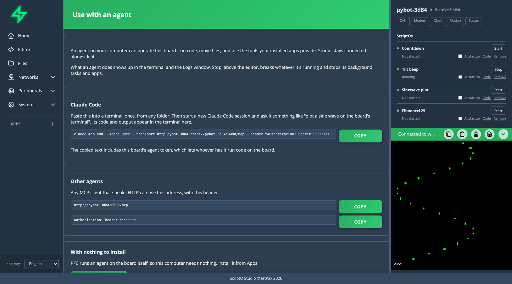
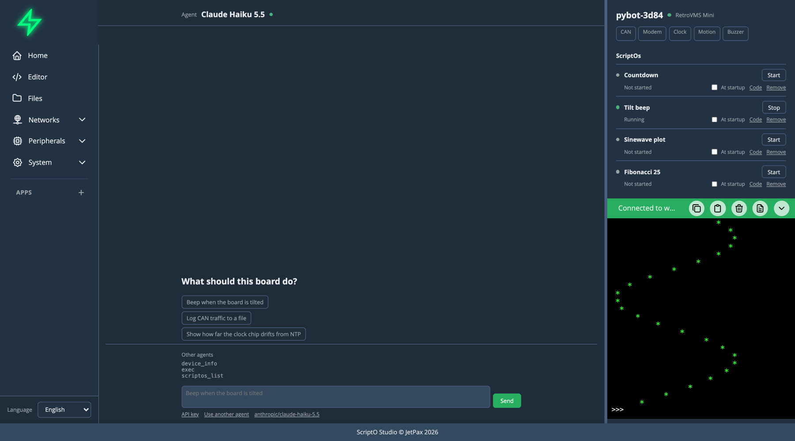

# Other Agents

Every board is an MCP server, so any MCP client can use it. An agent on your computer keeps your repos, your shell and its own tools, and Studio shows what it does on the board.

## Claude Code

1. Connect Studio to the board.
2. Open **System > Agent**.
3. Copy the line under **Claude Code** and paste it into a terminal, once, from any folder.
4. Start a new Claude Code session and ask it something, like "plot a sine wave on the board's terminal".



The line looks like this:

```bash
claude mcp add --scope user --transport http <board> http://<board>/mcp --header "Authorization: Bearer <agent token>"
```

The token is hidden on screen and included in what you copy. It lets whoever has it run code on the board, so treat it like a password.

## Any other client

**Other agents**, in the same panel, gives the address and the header to use with any MCP client that speaks HTTP.

A client that keeps a WebSocket open at `wss://<board>/mcp` gets more: live progress from long tools, and it can break its own blocked `exec`. See the [MCP tools reference](../reference/mcp-tools.md).

## Watching it work

Stay connected in Studio. The agent's calls appear under **Other agents** on Home, and its code and output appear in the terminal, tagged with its name.



**Stop** under Other agents breaks whatever it's running, and stops ScriptOs and Apps too.

Permission prompts belong to the agent you're using, so Studio doesn't ask on its behalf.

## ss-relay

`ss-relay` is a small stdio MCP server you can run beside an agent. It passes the board's tools through and adds what needs your computer: syncing a folder by hash, moving files by path, discovery and flashing. It also suits a client that only speaks stdio.

```bash
claude mcp add pybot -e SS_RELAY_PASSWORD=<password> -- uvx ss-relay --device wss://pybot-6014.local/mcp
```

## Things to know

- **Plain HTTP isn't encrypted.** The default line uses it because agents won't accept a board's self-signed certificate, so the token crosses your network in clear. Use it on a network you trust.
- **A board holds three WebSockets.** A fourth client is refused with a message saying why, and nobody is pushed off. Studio holds one, and a second once its own agent has run. A client on plain HTTP holds none.
- **A ScriptO's long tools work differently over HTTP.** They return a job id to poll with `job_status`, and can't report live progress.
- **Tool lists can change.** Installing a ScriptO or App can add tools. A long-running session may keep the list it started with, so start a new one if a tool seems to be missing.

## An agent with no computer

PFC is an App that runs an agent on the board itself. Install it from **Apps**.
