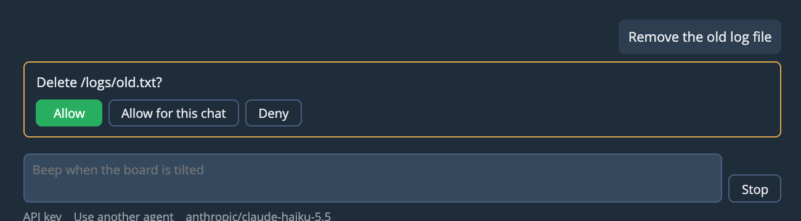

# Studio's Agent

Studio's agent runs in the browser page on Home. There's nothing to install. It works on one board, with that board's tools, and it's meant for getting something working on the board rather than for general coding.

## Your key and model

Studio's agent uses models through [OpenRouter](https://openrouter.ai), billed to your account.

- **API key** under the message box adds or changes your key. It stays in this browser, in a separate frame that Studio's pages and Apps can't read. Studio can ask that frame for a reply, but it can't read the key or choose where it's sent.
- The model's name beside it opens the model list, which you can search. Tick **Free only** to see the free ones. Any model that supports tools will do.

Free models have daily limits and vary in how well they use tools. If one struggles, try another.

## Asking

Type a request and press Enter, or Shift+Enter for a new line. If a ScriptO crashes, **Ask agent** on its row attaches the error to your next message.

The chat shows each of the agent's calls, and hovering over one shows its full output. What it runs with `exec` also appears in the terminal.

## When it asks first

The agent asks before what's hard to undo:

- Deleting a file
- Writing a file outside a ScriptO's own folder
- Replacing or removing a ScriptO it didn't make in this chat
- Resetting the board, or stopping user tasks
- `exec` code that plainly erases, flashes or resets
- A destructive tool added by a ScriptO or App

Choose **Allow**, **Allow for this chat** or **Deny**. If you deny it, the agent is told, and carries on without it or asks you.

This guards against accidents and isn't a sandbox. `exec` runs any Python, and the scan only catches what's plain to see.

## Stopping it

**Stop** beside the message box ends the agent and its current call, and leaves the board's ScriptOs running. Stop above the editor goes further, and stops ScriptOs and Apps too.

## Long chats

A chat stays when you reload the page, one for each board, until you click **New chat**. If the page closed partway through a request, the chat says it stopped there, and the agent is told which calls may have run. "Allow for this chat" doesn't carry over a reload, so it asks again.

The chat is stored in your browser, and it includes whatever the board printed.

To keep costs and limits in check:

- The model gets at most 20,000 characters of any one tool's output, keeping the start and the end. You can still see all of it by hovering over the call.
- When a chat gets long, its history is replaced by a summary written by the same model, plus your latest request word for word. A note in the chat says so, and hovering over the note shows the summary. Everything stays on your screen.
- A request stops after 40 rounds of tool calls. Tell it to carry on if it should.

## Selecting text

Click in the chat and press Cmd-A or Ctrl-A to select all of it, in order, ready to copy.
