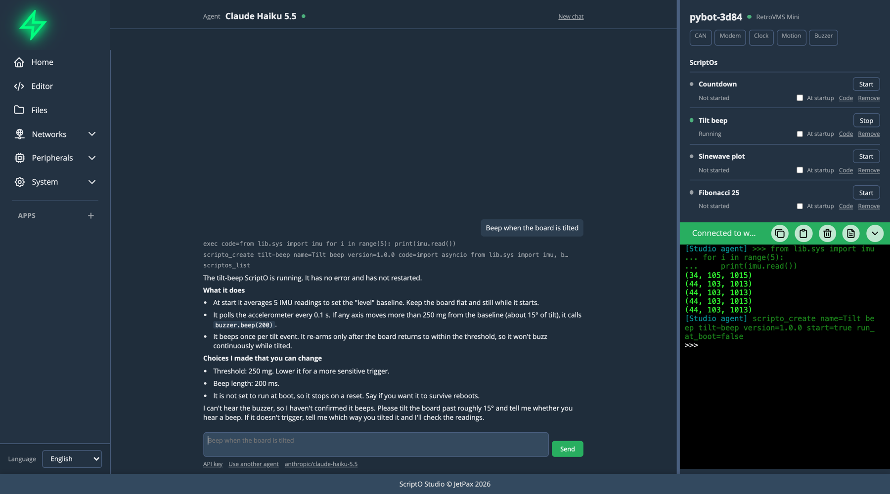

# Your First ScriptO

This walks through one request on a board with an accelerometer and a buzzer. On another board, ask for something it has hardware for.

## Ask

On Home, type:

```text
Beep when the board is tilted
```

## Watch



The chat shows each call the agent makes, and the terminal shows the code it runs and what that printed.

1. **It tries the hardware.** It calls `exec` to read the accelerometer and see what it reads at rest.
2. **It leaves a ScriptO.** It calls `scripto_create` with an id and the code. The code is checked before anything is written, so a mistake can't replace what's working.
3. **Studio checks on it.** Two seconds after a ScriptO starts, Studio tells the agent what became of it. If it crashed, the agent sees the error and can fix it.
4. **It reports.** It says what it did and what it couldn't check. An agent can't hear a buzzer, so it asks you to try it.

The ScriptO's row appears in the sidebar, marked **Running**.

## Try it

Tilt the board. It should beep once per tilt.

If it doesn't do what you wanted, say so in the same chat. The agent can read the sensor again, change the code and restart it.

## Keep it

The ScriptO keeps running after you close Studio. To have it start every time the board powers up, tick **At startup** on its row, or ask the agent.

From the row you can also:

- **Stop** or **Start** it.
- Read its code with **Code**, which opens it in the Editor.
- **Remove** it, which deletes its code and leaves its data.

## Where it lives

The code is at `/lib/ext/<folder>/main.py`, and `/lib/ext/registry.json` records what's installed. See [ScriptOs](../scriptos/index.md).
