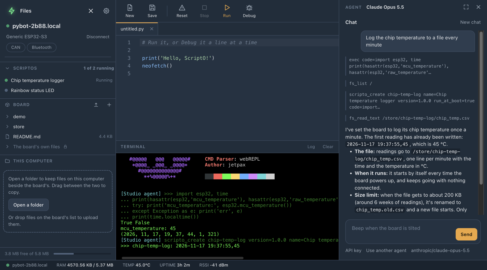

# Your First ScriptO

This walks through one request that any board can do: every ESP32 can read its own temperature.

## Ask

In the Agent, type:

```text
Log the chip temperature to a file every minute
```

## Watch



The chat shows each call the agent makes, and the terminal shows the code it runs and what that printed.

1. **It tries the hardware.** It calls `exec` to find the temperature sensor and read it.
2. **It leaves a ScriptO.** It calls `scripto_create` with an id and the code. The code is checked before anything is written, so a mistake can't replace what's working.
3. **Studio checks on it.** Two seconds after a ScriptO starts, Studio tells the agent what became of it. If it crashed, the agent sees the error and can fix it.
4. **It reports.** It says what it did, where the readings go, and what it couldn't check.

The ScriptO appears under **ScriptOs** in [Files](../user-guide/file-manager.md), marked **Running**.

## Try it

After a few minutes, open the file the agent named, in Files. There's a new line each minute.

If it doesn't do what you wanted, say so in the same chat. The agent can read the sensor again, change the code and restart it.

## Keep it

The ScriptO keeps running after you close Studio. To have it start every time the board powers up, choose **Run at startup** from its menu in Files, or ask the agent.

From its row you can also:

- Stop or start it, with the button that shows when you hover over it.
- Open its code in the editor, by clicking it.
- **Remove** it, from its menu, which deletes its code and leaves its data.

## Where it lives

The code is at `/lib/ext/<folder>/main.py`, and `/lib/ext/registry.json` records what's installed. See [ScriptOs](../scriptos/index.md).
