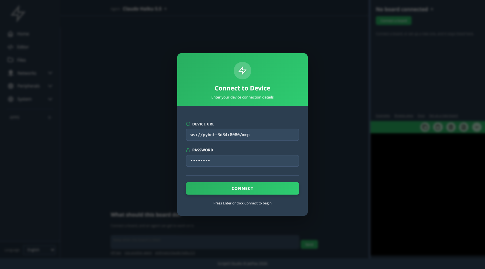
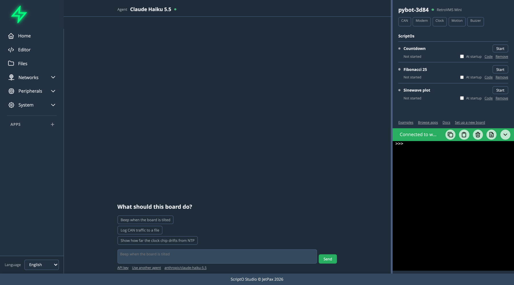

# Set Up a Board and Connect

You need an ESP32 board, a USB cable, and Chrome or Edge, because flashing uses Web Serial. Once a board is set up, it connects over your network from any browser.

## 1. Open Studio

Go to [scriptostudio.com/app](https://scriptostudio.com/app/). You can install it as an app from your browser's menu.

## 2. Set up a new board

1. Plug the board in with USB.
2. Click **Set up a new board** at the bottom of the sidebar. That opens **System > Firmware**.
3. Follow the steps to flash the firmware and give the board your WiFi details. Its certificate is generated for you.
4. Choose the board's password at `https://<host>.local/setup`. Your browser warns about the board's certificate the first time, because the board signed it itself. That's expected, so proceed to it.
5. The board sends you back to Studio with its address filled in.

See [Flashing Firmware](../device-setup/flashing-firmware.md) and [Provisioning](../device-setup/provisioning.md) for the details.

## 3. Connect

Click **Connect a board**, or **Connect** beside a board you've used before.

- **Device URL** is the board's address, such as `wss://pybot-6014.local/mcp`.
- **Password** is the one you chose during setup.

The board then appears in the sidebar with what it has, such as CAN, Clock or Motion, and the ScriptOs on it.

## 4. Add an API key

Studio's agent runs in your browser and uses models through [OpenRouter](https://openrouter.ai), on your own account.

1. Click **Add an API key** under the message box, and paste your key.
2. Click the model's name beside it to choose another model. Tick **Free only** to see the free ones.

The key stays in this browser, in a separate frame that Studio's pages and Apps can't read.

If you'd rather use Claude Code or another agent, see [Other Agents](../agent/other-agents.md). You don't need a key for that.

## 5. Ask for something

Type what the board should do, or pick a suggestion. Suggestions come from what the board says it has.

Next: [Your First ScriptO](first-scripto.md).
