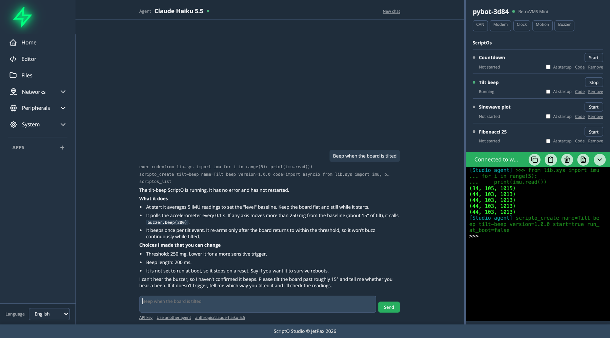

# A Tour of Studio

## The menu, on the left

- **Home** is the chat with Studio's agent.
- **Editor** edits and runs code, with a debugger. See [Editor](../user-guide/editor-features.md).
- **Files** moves files between the board and your browser's storage. See [Files](../user-guide/file-manager.md).
- **Networks** configures WiFi, Ethernet, VPN, Bluetooth LE, WWAN, MQTT, Telephony, NTP and CAN.
- **Peripherals** configures GPS, Modem and SD Card.
- **System** has About, Settings, Agent and Firmware.
- **Apps** lists what's installed, and **+** adds more.

The language selector is at the bottom.

## The main pane, in the centre

Whatever you pick from the menu appears here. The chat waits on Home while you're elsewhere, and a banner on other views tells you when it needs an answer.

## The sidebar, on the right

It stays in every view:

- **The board** and what it has, or a list of boards you've used when none is connected.
- **ScriptOs**, each with Start or Stop, At startup, Code and Remove.
- **The terminal**, the board's one REPL, once a board is connected. See [Terminal](../user-guide/terminal.md).

Drag the divider on its left to make it wider, for long terminal output. Studio remembers the width.

## Stopping things

- **Stop** in the chat ends Studio's agent and its call, and leaves everything else running.
- **Stop** above the editor, and under **Other agents** on Home, breaks whatever is running, whichever client started it, and stops ScriptOs and Apps as well.
