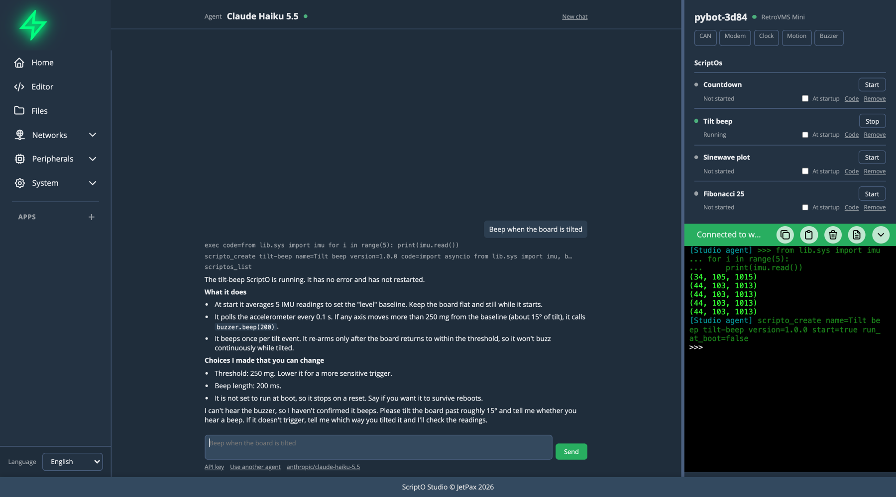

# ScriptO Studio

Tell your board what to do. An agent writes the MicroPython, tries it on your real hardware and leaves it running on the board. You watch every call, and you can stop it at any moment.

## Start here

- [Set up a board and connect](getting-started/index.md)
- [Make your first ScriptO](getting-started/first-scripto.md)
- [Use Studio's agent](agent/studio-agent.md), which runs in the browser with nothing to install
- [Connect Claude Code or another agent](agent/other-agents.md)

## The words used here

**Studio**
:   The app you run in a browser or install. It's where you work with an agent and watch what it does.

**Board**
:   An ESP32 running MicroPython and Studio's firmware. Each board is an MCP server, so any agent that speaks MCP can use it.

**ScriptO**
:   MicroPython left on the board to stay. It keeps running with nobody connected and can start at boot. It's what an agent leaves behind. See [ScriptOs](scriptos/index.md).

**App**
:   A ScriptO with a browser side as well, for tools that need a screen, like OpenInverter. See [Apps](apps/index.md).

**MCP**
:   The Model Context Protocol, the open standard that agents use to call tools. It's the board's only protocol, and Studio uses it too.

## How it fits together

The board is the source of truth. What's installed, what runs at boot, what tools exist and what hardware it has all live on the board, so any agent finds them there.

- **Studio's agent** runs in the page, on your own OpenRouter key.
- **Outside agents** like Claude Code run on your computer and connect to the board directly. They keep your repos, your shell and their own tools.
- **Studio** stays connected beside them and shows every call as it happens.

Read [how agents work with a board](agent/index.md) for more, or the [architecture](developer/architecture.md) for how it's built.
