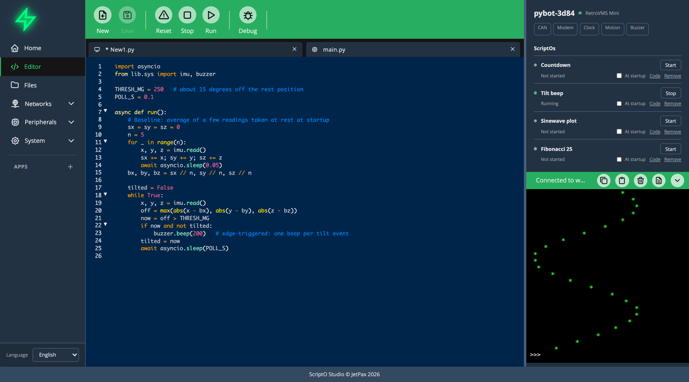

# ScriptOs

A ScriptO is MicroPython left on the board to stay. It runs with nobody connected and can start at boot, and it's what an agent leaves behind.

## What one is made of

| Part | Where it lives | What it does |
|---|---|---|
| Its own work | `/lib/ext/<folder>/main.py`, with `async def run()` | Runs as a user task, with nobody connected |
| Tools for agents | `/lib/ext/<folder>/tools/<name>.py` | Appear to any agent as `<scripto>_<name>` |
| Startup record | `run_at_boot` in `/lib/ext/registry.json` | Starts it at every boot |

A ScriptO needs at least one of `main.py` or a tool. See [Writing ScriptOs](writing-scriptos.md).

## In the sidebar

Each ScriptO has a row with its state: **Running**, **Stopped**, **Not started** or **Crashed**, and why it stopped.

- **Start** and **Stop**
- **At startup** to run it at boot
- **Code** to open it in the Editor
- **Remove** to delete its code. Its data stays.
- **Ask agent**, when it has crashed, to attach the error to your next message

## At boot

The board starts its boot ScriptOs before it brings up the network or the servers, so one still runs where there's no WiFi.

## What bad code can do

| Failure | What happens |
|---|---|
| A Python exception | Shown on its row and in `scriptos_list`, then retried |
| It holds the event loop | The watchdog names it in the log, then breaks it about 5 seconds later |
| A crash in C | Crash resets are counted. After 3 in a row the board starts without its boot ScriptOs, and Studio says why |

## ScriptOs and Apps

An [App](../apps/index.md) is a ScriptO with a browser side as well, written in JavaScript, for tools that need a screen. Agents make ScriptOs and don't write Apps.
