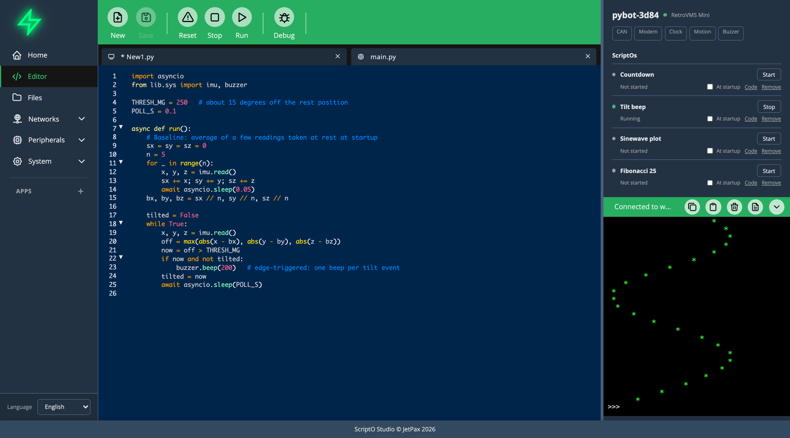

# Editor Features

The Editor edits files on the board or in your browser storage. Open it with **Editor** in the menu.

The editor is CodeMirror 6. It has Python and JSON highlighting, line numbers, folding, bracket matching, search and undo history.

## Toolbar

| Button | Action | Shortcut |
|--------|--------|----------|
| **New** | Create a file. | Ctrl+N / Cmd+N |
| **Save** | Save the current file. | Ctrl+S / Cmd+S |
| **Reset** | Reset the board. | |
| **Stop** | Interrupt what's running and stop background tasks. | |
| **Run** | Run the current file on the board. | Ctrl+R / Cmd+R |
| **Debug** | Start a debug session. See [Debugging](debugging.md). | |

## Tabs

Each open file has a tab. A CPU icon means the file is on the board, and a desktop icon means it's in browser storage. A `*` marks unsaved changes.

- Click a tab to switch to it.
- Click the name on the active tab to rename the file.
- Click the **x** to close it.

## Run

**Run** sends the editor's current text to the board, saved or not. Output appears in the [terminal](terminal.md) in the sidebar.

## JSON mode

Files that end in `.json` get JSON highlighting. When you open one that holds a JSON object or array, Studio reformats it with two-space indentation.

## Breakpoints

Click the gutter beside a line number to set a breakpoint. See [Debugging](debugging.md).

## Other shortcuts

| Shortcut | Action |
|----------|--------|
| Ctrl+L / Cmd+L | Clear the terminal. |
| Ctrl+Shift+C / Cmd+Shift+C | Open the connect dialog. |

## Related

- [File Manager](file-manager.md)
- [Terminal](terminal.md)
- [Debugging](debugging.md)
- [Writing ScriptOs](../scriptos/writing-scriptos.md)
