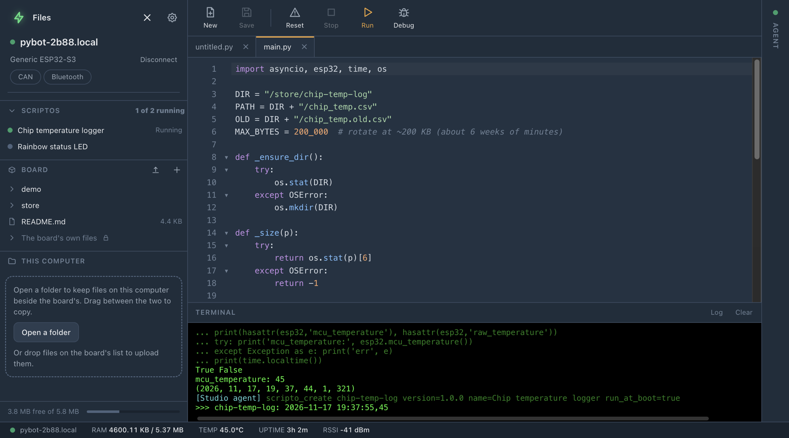

# Editor Features

The editor fills the top of Studio. It edits files on the board, or in a folder on your computer that you've opened in [Files](file-manager.md).

The editor is CodeMirror 6. It has Python and JSON highlighting, line numbers, folding, bracket matching, search and undo history.

## Toolbar

| Button | Action | Shortcut |
|--------|--------|----------|
| **New** | Start a new file. A new Python file holds a short test: it prints Hello, ScriptO! and calls `neofetch()`. | |
| **Save** | Save the file. A new file asks where on the board it goes. | Ctrl+S / Cmd+S |
| **Reset** | Restart the board's Python, or the whole board. | |
| **Stop** | Break whatever is running, and stop ScriptOs and Apps too. | |
| **Run** | Run the file, or only what's selected in it. With the debugger showing, run the file in it. | Ctrl+Enter / Cmd+Enter |
| **Debug** | Show or hide the debugger. See [Debugging](debugging.md). | F5 |

Studio opens on a new file when nothing is open, so **Run** is a one-click test of the board.

## Tabs

Each open file has a tab. A dot marks unsaved changes; Studio keeps unsaved files in this browser until you save them.

- Click a tab to switch to it.
- Click the **×** to close it. If it has unsaved changes, Studio asks first.

## Run

**Run** sends the editor's text to the board, saved or not, and its output appears in the [terminal](terminal.md) beneath. With part of the file selected, it runs only that.

## JSON

Files that end in `.json` get JSON highlighting.

## Breakpoints

Click the gutter beside a line number to set a breakpoint. See [Debugging](debugging.md).

## Related

- [Files](file-manager.md)
- [Terminal](terminal.md)
- [Debugging](debugging.md)
- [Writing ScriptOs](../scriptos/writing-scriptos.md)
