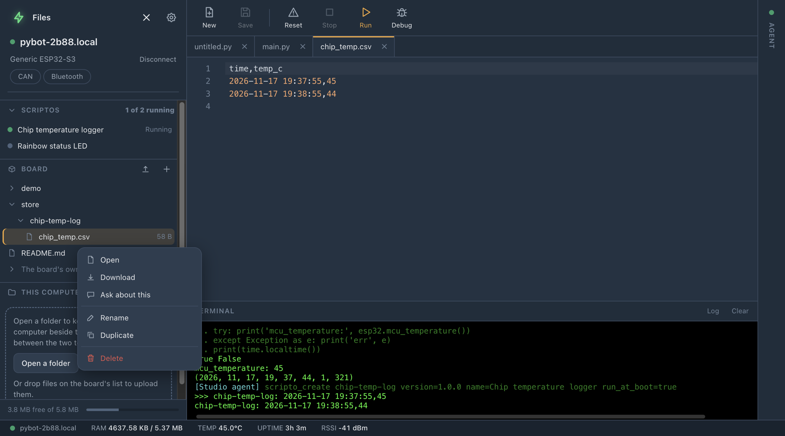

# Files

The folder button at the top of the sidebar shows **Files** in place of the Apps. Whatever is in the centre stays there, and opening a file brings Studio forward. Click the **×** in the button's place to go back to the Apps. Drag the sidebar's right edge to make it wider.

Files has three parts.

| Part | Shows |
|------|-------|
| **ScriptOs** | What's installed on the board, and whether each is running. |
| **Board** | The board's files and folders. |
| **This computer** | A folder on your computer, once you open one. |

## ScriptOs

Each row has a dot that says whether the ScriptO is running, stopped or crashed.

- Hover over a row for its start or stop button.
- Click a row to open its code in the editor.
- Right-click it, or click its **⋯**, for **Run at startup**, **Open the code**, **Ask about the crash** when it has crashed, and **Remove**.

Click the **ScriptOs** heading to fold the list away. An App's own ScriptO belongs to the App, so it isn't listed here.

## The board's files

- Click a file to open it in the editor. Click a folder to open or close it.
- Shift-click or Cmd-click to select several.
- Right-click for **Open**, **Download**, **Ask about this**, **Rename**, **Duplicate** and **Delete**.
- The upload button in the **Board** heading sends files from your computer to the board. Its **+** has **New file**, **New folder**, **Upload files**, **Back up the board** and **Refresh**.
- Drag a file or folder onto a folder to move it. Drop files from your computer onto the list to upload them.

The board's own files, the ones botIQ runs on, are folded away under **The board's own files**. Studio warns before you rename or delete one of them.

> [!WARNING]
> Deleting `boot.py` or breaking `main.py` can keep the board from starting.

The bar at the bottom shows how much space the board has free.

## This computer

Click **Open a folder** to keep files on your computer beside the board's. Chrome and Edge allow this; the browser asks again before Studio uses the folder in a later visit.

- Drag between the two places to copy.
- Right-click a folder on your computer for **Restore to the board**, which writes everything in it to the same place on the board.
- **Back up the board**, in the board's **+**, copies all the board's files into a dated folder here. It leaves out the board's certificate and its settings file, which holds the Wi-Fi password.

## Related

- [Editor Features](editor-features.md)
- [Terminal](terminal.md)
- [Settings](settings.md)
