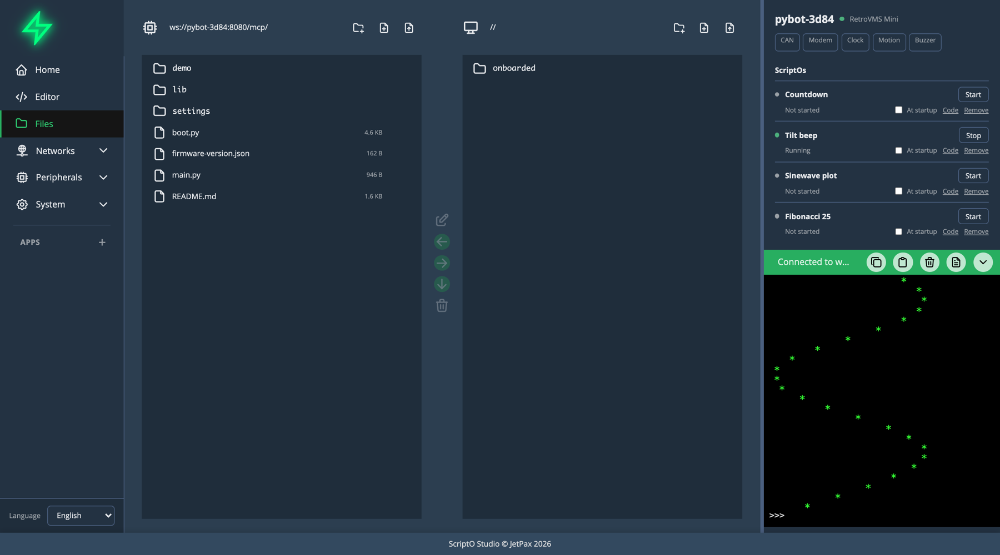

# File Manager

The File Manager shows the board's files next to files kept in your browser, and moves files between them.

Open it with **Files** in the menu.

## The two panes

| Pane | Shows |
|------|-------|
| Left | The board's filesystem. It reads **Connect to board** until a board is connected. |
| Right | Browser storage: files Studio keeps in your browser, on your computer. |

Each pane has a header with its path and three buttons: new folder, new file, and upload (left pane) or import (right pane). Files show their size. Folders are listed first.

Between the panes is a column of buttons that act on what you've selected:

| Button | Action |
|--------|--------|
| Edit (pencil) | Open the selected files in the editor. |
| Left arrow | Copy the selection from browser storage to the board. |
| Right arrow | Copy the selection from the board to browser storage. |
| Down arrow | Export the selected files to your computer, as browser downloads. |
| Trash | Delete the selection. |

## Select, open and navigate

- Click an item to select it. Click it again to clear it.
- Double-click a file to open it in the editor.
- Double-click a folder to go into it. Click `..` at the top of the list to go up.

## Create, rename and delete

- **New file** and **New folder** add an empty entry to the list with a name field. Type a name and press Enter. Press Escape to cancel.
- **Rename**: click the text-cursor icon at the end of a row, edit the name, and press Enter.
- **Delete**: select items, click the trash button and confirm. The confirmation lists what will go.

> [!WARNING]
> Deleting `boot.py` or breaking `main.py` can keep the board from starting.

## Move files

- **Copy to the board or to browser storage** with the arrow buttons. If a file of the same name is already at the destination, Studio lists the files it would overwrite and asks first.
- **Upload** (left pane header) sends files from your computer straight to the board.
- **Import** (right pane header) brings files from your computer into browser storage.
- **Export** (down arrow) saves the selected files from either pane to your computer.

## Related

- [Editor Features](editor-features.md)
- [Terminal](terminal.md)
- [Settings](settings.md)
